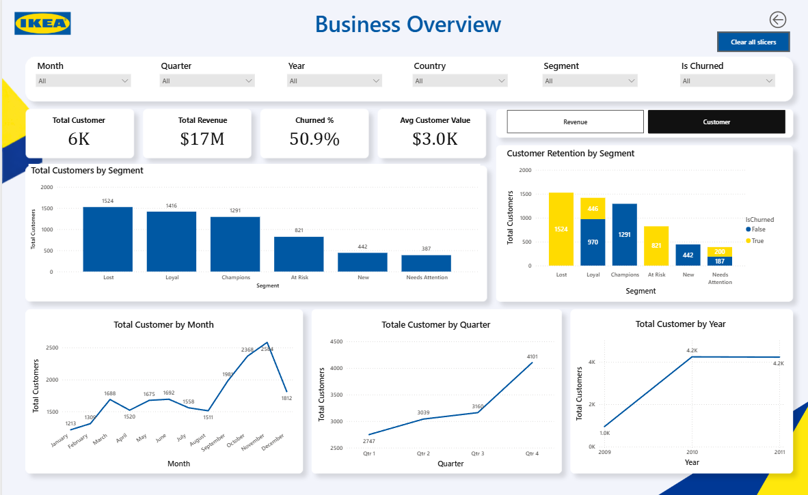
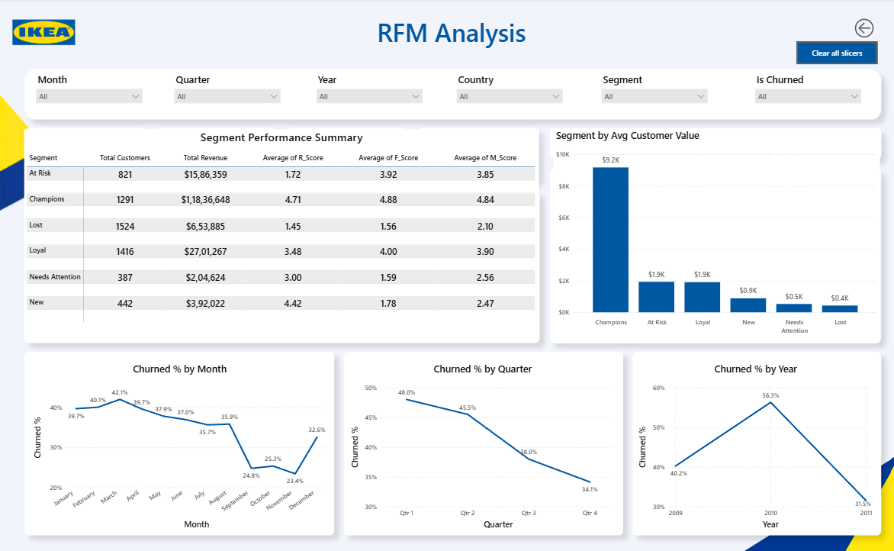

# IKEA Gifting — Customer Analytics & RFM Segmentation

**Author:** Manish Kumar  
**Project Type:** Personal Data Analytics Portfolio Project

An end-to-end analytics project using SQL Server, Python, pandas, and Power BI to prepare transactional data, segment customers using RFM analysis, investigate customer inactivity, and communicate business insights through an interactive dashboard.

> **Disclaimer:** IKEA Gifting is a fictional business created for this portfolio project and is not affiliated with the real IKEA corporation. The analysis uses the public Online Retail II dataset. Results do not represent the performance of IKEA or any actual IKEA business.

## Dashboard Preview

### RFM Analysis

## Business Problem

1. Revenue depends on one segment. Champions produce 68.13% of revenue, so any
drop in this group affects the business most.
2. Half of the customers are inactive. Churned % is 50.9%, and it is not clear which
groups can still be brought back.
3. Loyal customers are leaving. 446 of the 1,416 Loyal customers are marked as
churned.
4. New customers do not come back. New customers have recent purchases
(R_Score 4.42) but a low F_Score of 1.78.
5. Sales and churn vary across the year. Revenue peaks in October and November,
while churn changes sharply from month to month.

## Tools and Technologies

- SQL Server and SSMS
- Python and pandas
- Jupyter Notebook
- Power BI Desktop
- DAX

## Project Workflow

1. Defined business requirements and analytical questions.
2. Combined and cleaned transactional data using SQL.
3. Calculated Recency, Frequency, and Monetary metrics in Python.
4. Scored customers and assigned RFM segments.
5. Applied a 90-day inactivity rule to flag churned customers.
6. Built an interactive Power BI dashboard to explore customer value, segment revenue, and churn trends.

## Customer Segments

- Champions
- Loyal
- At Risk
- New
- Needs Attention
- Lost

## Key Findings

The supplied dashboard displays approximately 6K customers, $17M in revenue, 50.9% churn, and $3.0K average customer value. Champions account for approximately 68.13% of displayed revenue.

These figures should be reconciled against the final Power BI measures and analysis outputs before being treated as independently validated results.

## Repository Contents

- `docs/` — case study report and business requirements
- `data/` — dataset information and approved sample data, if included
- `sql/` — data cleaning and validation scripts
- `python/` — RFM analysis notebook and dependencies
- `powerbi/` — Power BI report and dashboard screenshots

## Case Study

See [`docs/IKEA_Gifting_Dashboard_Case_Study.pdf`](docs/IKEA_Gifting_Dashboard_Case_Study.pdf) for the detailed case study.

## Data Source

Online Retail II — UCI Machine Learning Repository, donated by Daqing Chen. The dataset covers historical transactions from December 2009 to December 2011.

## Limitations

- Churn is defined using a fixed 90-day inactivity threshold.
- The project does not include a predictive churn model.
- Findings are based on historical transaction data.
- Revenue currency and KPI calculations should be verified before publication.

**Manish Kumar**
